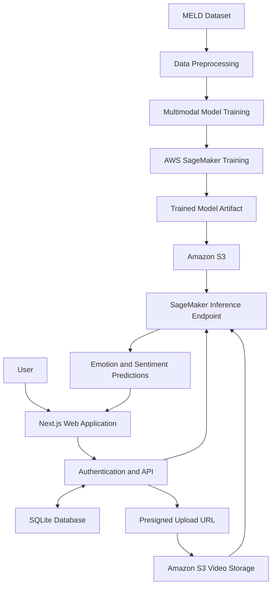
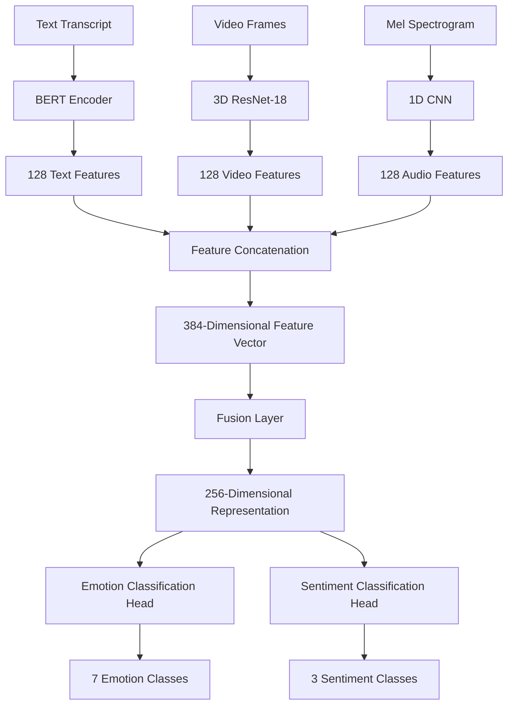
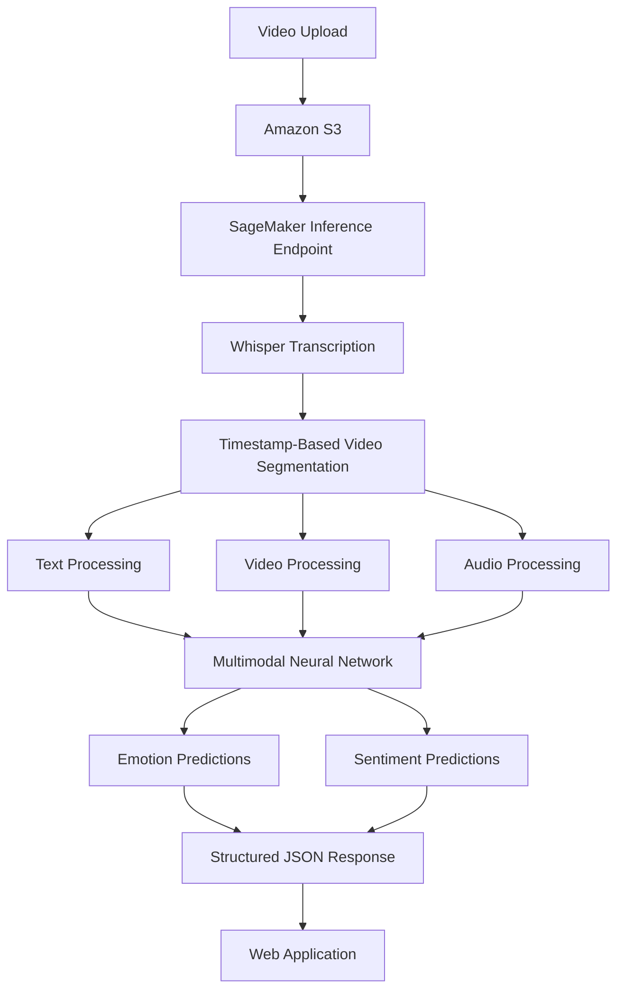

# AI Video Sentiment & Emotion Analysis

An end-to-end multimodal deep learning system that analyzes video content to identify emotions and sentiments using visual, audio, and textual information.

The project combines a custom PyTorch neural network architecture with an AWS-based machine learning infrastructure and a full-stack web application. Users can upload videos, receive timestamped emotion and sentiment predictions, and programmatically access the model through a REST API.

## Features

- Multimodal deep learning using text, audio, and video features.
- Custom neural network architecture with dedicated modality encoders and feature fusion.
- Multi-task classification for simultaneous emotion and sentiment prediction.
- Automated speech transcription and video segmentation using OpenAI Whisper.
- GPU-based model training and inference using AWS SageMaker.
- Model performance monitoring and evaluation using TensorBoard.
- Full-stack web application for video uploads and analysis.
- Timestamped predictions with confidence scores for individual utterances.
- REST API with API key authentication, request quotas, and file ownership validation.
- Direct video uploads to Amazon S3 using presigned URLs.
- User authentication and account management.

## Technology Stack

| Category | Technologies |
|---|---|
| Programming Languages | Python, TypeScript, JavaScript, SQL |
| Deep Learning | PyTorch, TorchVision, TorchAudio |
| Natural Language Processing | BERT, Hugging Face Transformers |
| Computer Vision | 3D ResNet-18, OpenCV |
| Audio Processing | 1D CNN, Mel Spectrograms, FFmpeg |
| Speech Recognition | OpenAI Whisper |
| Model Evaluation | Scikit-learn, TensorBoard |
| Frontend | Next.js, React, Tailwind CSS |
| Backend | Next.js, REST API, Node.js |
| Database | SQLite, Prisma ORM |
| Authentication | Auth.js, bcrypt, API Keys |
| Cloud Infrastructure | AWS SageMaker, Amazon S3, AWS IAM |
| Development Tools | Git, npm, Zod |

## System Architecture

The system consists of three primary components:

1. Machine learning training and evaluation pipeline.
2. Cloud-based model deployment and inference infrastructure.
3. Full-stack web application and REST API.



## Machine Learning Architecture

The model uses a multimodal neural network that independently extracts features from three input modalities before combining them into a shared representation.

### Modality Encoders

| Modality | Architecture | Output |
|---|---|---|
| Text | Pretrained BERT with linear projection | 128-dimensional feature vector |
| Video | Pretrained 3D ResNet-18 | 128-dimensional feature vector |
| Audio | 1D Convolutional Neural Network | 128-dimensional feature vector |

### Feature Fusion

The feature vectors generated by the three encoders are concatenated into a 384-dimensional representation.

A fully connected fusion layer transforms this representation into a shared 256-dimensional feature vector, incorporating batch normalization, ReLU activation, and dropout.

The shared representation is then passed to two independent classification heads.



### Classification Outputs

**Emotion Classification**

- Anger
- Disgust
- Fear
- Joy
- Neutral
- Sadness
- Surprise

**Sentiment Classification**

- Positive
- Negative
- Neutral

Both classification tasks are supported by a single multimodal model using separate output heads.

## Dataset

The training pipeline uses the Multimodal EmotionLines Dataset (MELD), a multimodal dataset containing approximately 13,000 utterances from over 1,300 dialogues from the television series Friends.

Each utterance contains:

- Video recordings
- Audio recordings
- Text transcripts
- Emotion labels
- Sentiment labels

The dataset is divided into training, validation, and testing sets.

Dataset source: [MELD Dataset](https://affective-meld.github.io/)

## Data Preprocessing

### Text Processing

- Tokenize utterances using the BERT tokenizer.
- Pad or truncate sequences to 128 tokens.
- Generate input IDs and attention masks.
- Extract contextual text embeddings using BERT.

### Video Processing

- Extract up to 30 frames from each video segment using OpenCV.
- Resize frames to 224 × 224 pixels.
- Normalize pixel values.
- Pad shorter video sequences to maintain consistent input dimensions.
- Extract spatiotemporal features using 3D ResNet-18.

### Audio Processing

- Extract audio from video files using FFmpeg.
- Convert audio into a 16 kHz mono waveform.
- Generate Mel spectrograms with 64 Mel frequency bands.
- Normalize spectrogram values.
- Pad or truncate spectrograms to 300 time steps.
- Extract audio features using a 1D convolutional neural network.

## Model Training

The training pipeline is implemented using PyTorch and configured for GPU-based training through AWS SageMaker.

### Training Configuration

| Parameter | Configuration |
|---|---|
| Framework | PyTorch 2.5.1 |
| Python Version | Python 3.11 |
| AWS Instance | ml.g5.xlarge |
| Optimizer | Adam |
| Loss Function | Weighted Cross-Entropy Loss |
| Learning Rate | Encoder-specific learning rates |
| Learning Rate Scheduler | ReduceLROnPlateau |
| Batch Size | 32 |
| Epochs | 25 |
| Label Smoothing | 0.05 |
| Weight Decay | 0.00001 |

The training pipeline incorporates:

- Transfer learning using pretrained BERT and ResNet models.
- Frozen encoder layers to reduce trainable parameters.
- Class weighting to address imbalanced training data.
- Multi-task learning for emotion and sentiment classification.
- Dropout and weight decay for regularization.
- Adaptive learning rate scheduling.
- Model checkpointing based on validation loss.
- GPU memory monitoring.

### Model Evaluation

The model evaluation pipeline tracks:

- Training loss
- Validation loss
- Test loss
- Emotion classification accuracy
- Emotion classification precision
- Sentiment classification accuracy
- Sentiment classification precision

Training and evaluation metrics are logged using TensorBoard.

## Inference Pipeline

The trained model can be deployed as an AWS SageMaker inference endpoint.

When a user uploads a video, the inference pipeline performs the following operations:

1. Upload the video to Amazon S3.
2. Invoke the SageMaker inference endpoint.
3. Retrieve the video from Amazon S3.
4. Transcribe speech using OpenAI Whisper.
5. Segment the video using transcription timestamps.
6. Extract text, audio, and visual features from each segment.
7. Perform multimodal model inference.
8. Convert model outputs into probabilities using Softmax.
9. Return the three highest-scoring emotion and sentiment predictions for each utterance.



## Web Application

The full-stack web application provides an interface for interacting with the deployed machine learning model.

### Application Features

- User registration and login.
- Video uploads and automated analysis.
- Overall emotion and sentiment summaries.
- Timestamped analysis of individual utterances.
- Speech transcript visualization.
- Emotion and sentiment confidence scores.
- Personal API key generation.
- API request quota tracking.
- API usage examples for developers.

The application uses Next.js for frontend and backend functionality, Prisma ORM for database operations, and SQLite for persistent storage.

## REST API

The application exposes REST API endpoints that allow developers to integrate video sentiment analysis into external applications.

All analysis and upload requests require an API key provided through the Authorization header.

```http
Authorization: Bearer YOUR_API_KEY
```

### API Endpoints

| Method | Endpoint | Description |
|---|---|---|
| POST | `/api/upload-url` | Generate a presigned S3 upload URL |
| PUT | Presigned S3 URL | Upload a video directly to Amazon S3 |
| POST | `/api/sentiment-inference` | Analyze an uploaded video |

### Example Usage

#### 1. Request an Upload URL

```bash
curl -X POST http://localhost:3000/api/upload-url \
  -H "Authorization: Bearer YOUR_API_KEY" \
  -H "Content-Type: application/json" \
  -d '{"fileType": ".mp4"}'
```

The response contains a presigned upload URL and a unique file key.

#### 2. Upload the Video

```bash
curl -X PUT "PRESIGNED_UPLOAD_URL" \
  -H "Content-Type: video/mp4" \
  --data-binary @video.mp4
```

#### 3. Request Sentiment Analysis

```bash
curl -X POST http://localhost:3000/api/sentiment-inference \
  -H "Authorization: Bearer YOUR_API_KEY" \
  -H "Content-Type: application/json" \
  -d '{"key": "YOUR_FILE_KEY"}'
```

The API returns an analysis object containing timestamped utterances, transcribed text, emotion predictions, sentiment predictions, and their associated confidence scores.

## Repository Structure

```text
AI-video-sentiment-model/
│
├── video-sentiment-model-training/
│   ├── dataset/
│   │   └── README.txt
│   │
│   ├── training/
│   │   ├── models.py
│   │   ├── meld_dataset.py
│   │   ├── train.py
│   │   ├── install_ffmpeg.py
│   │   ├── count_parameters.py
│   │   ├── test_logging.py
│   │   └── requirements.txt
│   │
│   ├── deployment/
│   │   ├── deploy_endpoint.py
│   │   ├── inference.py
│   │   ├── models.py
│   │   └── requirements.txt
│   │
│   └── train_sagemaker.py
│
├── web-app/
│   ├── prisma/
│   │   └── schema.prisma
│   │
│   ├── src/
│   │   ├── actions/
│   │   ├── app/
│   │   │   ├── api/
│   │   │   ├── login/
│   │   │   └── signup/
│   │   ├── components/
│   │   ├── lib/
│   │   ├── schemas/
│   │   ├── server/
│   │   ├── styles/
│   │   └── env.js
│   │
│   └── package.json
│
├── .gitignore
└── README.md
```

## Installation and Setup

### Prerequisites

- Python 3.11
- Node.js and npm
- FFmpeg
- AWS account and configured credentials
- Amazon S3 bucket
- AWS SageMaker execution and deployment roles
- MELD dataset
- CUDA-compatible GPU recommended for training

### Clone the Repository

```bash
git clone https://github.com/haszee/AI-video-sentiment-model.git

cd AI-video-sentiment-model
```

### Model Training Setup

Navigate to the machine learning directory.

```bash
cd video-sentiment-model-training
```

Create a virtual environment and install the training dependencies.

```bash
python -m venv venv

source venv/bin/activate

pip install -r training/requirements.txt
pip install scikit-learn
```

Download and extract the MELD dataset using the following directory structure:

```text
dataset/
├── train/
│   ├── train_sent_emo.csv
│   └── train_splits/
├── dev/
│   ├── dev_sent_emo.csv
│   └── dev_splits_complete/
└── test/
    ├── test_sent_emo.csv
    └── output_repeated_splits_test/
```

Upload the dataset to Amazon S3 and update the bucket names and IAM execution role in `train_sagemaker.py`.

Start the SageMaker training job:

```bash
python train_sagemaker.py
```

### Model Deployment

Package the trained model checkpoint as a SageMaker-compatible model artifact and upload it to Amazon S3.

Navigate to the deployment directory:

```bash
cd deployment
```

Update the model artifact URI and IAM deployment role in `deploy_endpoint.py`.

Deploy the model:

```bash
python deploy_endpoint.py
```

The deployment script provisions a SageMaker inference endpoint that can be invoked by the web application.

### Web Application Setup

From the repository root:

```bash
cd web-app

npm install
```

Create a `.env` file with the following environment variables:

```env
DATABASE_URL="file:./db.sqlite"

AUTH_SECRET="your-auth-secret"

AWS_REGION="your-aws-region"
AWS_ACCESS_KEY_ID="your-access-key"
AWS_SECRET_ACCESS_KEY="your-secret-access-key"

AWS_INFERENCE_BUCKET="your-s3-bucket"
AWS_ENDPOINT_NAME="sentiment-analysis-endpoint"
```

Replace the placeholder S3 bucket name in `src/app/api/sentiment-inference/route.ts` with your configured inference bucket.

Initialize the database:

```bash
npx prisma generate
npx prisma db push
```

Start the development server:

```bash
npm run dev
```

Access the application at:

```text
http://localhost:3000
```

## Potential Applications

- Multimodal sentiment analysis
- Video content analytics
- Conversational AI
- Human-computer interaction
- Media and entertainment analytics
- Customer feedback analysis
- Multimodal machine learning research

## Limitations

- The model is trained on dialogue data from the MELD dataset and may not generalize equally well to other environments.
- Predictions depend on speech transcription accuracy and audio and video quality.
- The current video preprocessing pipeline processes a maximum of 30 frames per utterance.
- Emotion predictions represent model classifications rather than verified emotional states.
- Cloud-based training and inference require AWS resources and may incur costs.

## Future Improvements

- Experiment with attention-based multimodal feature fusion.
- Fine-tune pretrained modality encoders.
- Train the audio encoder's convolutional layers.
- Incorporate additional multimodal emotion recognition datasets.
- Introduce temporal modeling across consecutive utterances.
- Optimize model size and inference latency.
- Implement asynchronous processing for longer videos.
- Add comprehensive automated testing and CI/CD pipelines.
- Explore real-time video sentiment analysis.

## Acknowledgements

- MELD: Multimodal EmotionLines Dataset
- PyTorch
- Hugging Face Transformers
- OpenAI Whisper
- AWS SageMaker
- Next.js
